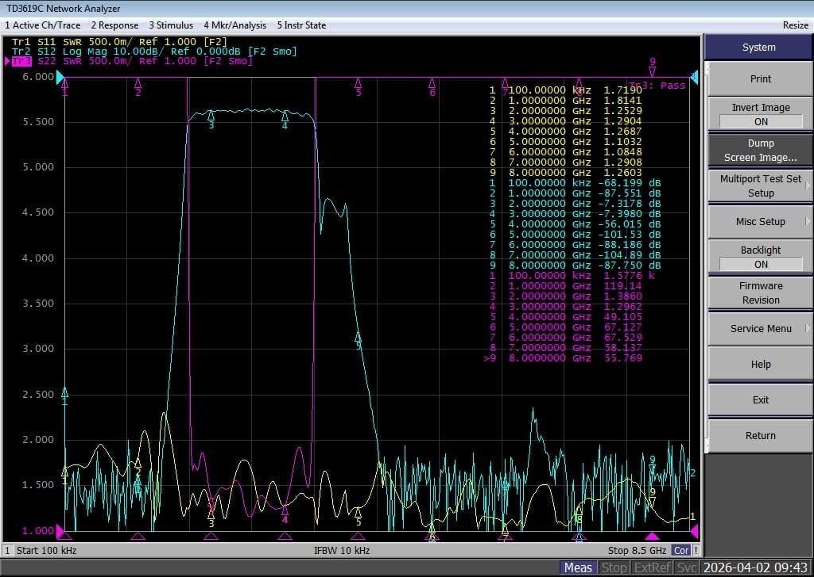
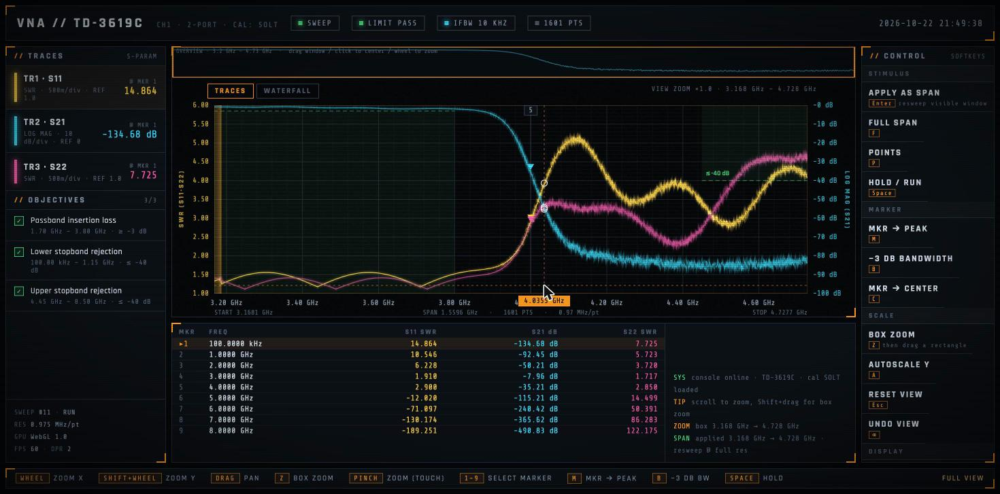

# VNA Tactical Console

A concept redesign of a vector network analyzer UI, built as a single self-contained HTML file.
Synthetic data, real interaction. Think *Call of Duty: Modern Warfare* briefing screen, but the
thing on screen is S‑parameters of a bandpass filter.

**[▶ Open the live prototype](https://htmlpreview.github.io/?https://github.com/vlad-bel/vna-test/blob/main/vna-prototype.html)**
— or just download `vna-prototype.html` and double-click it. No build, no dependencies.

| The instrument (TD3619C, 100 kHz – 8.5 GHz) | The prototype |
|---|---|
|  |  |

## Why

Bench VNAs still ship with a UI designed around physical softkeys from the 1980s HP/Agilent era,
running on Windows Embedded and an Intel Atom. Nobody buys a VNA for its interface, so nobody
redesigns it. This is an experiment: what if the interaction model borrowed from games instead?

- **Objectives, not limit lines.** Limit tests become a checklist with ✓ / ✕ and the worst offender's value.
- **Contextual key bar.** The bottom row shows only the shortcuts that make sense right now.
- **Event feed.** Every action leaves a one-line trace, like a kill feed.
- **Two kinds of zoom.** *View zoom* stretches the measured points (dots appear when sparse).
  *Apply as span* (Enter) resweeps the visible window at full resolution. A minimap on top always shows where you are.
- **Marker intelligence.** Snap to peak, find −3 dB bandwidth, center on marker — one key each.
- **Waterfall.** Optional 2.5D history of sweeps, the only "3D" allowed in the budget.

## Controls

| Action | Input |
|---|---|
| Zoom X around cursor | Mouse wheel |
| Zoom Y | Shift + wheel |
| Pan | Drag |
| Box zoom | `Z`, then drag a rectangle (or Shift + drag) |
| Reset view / Undo view | `Esc` / `Backspace` |
| Apply visible window as span | `Enter` |
| Full span | `F` |
| Sweep points (201 → 1601) | `P` |
| Hold / Run | `Space` |
| Marker → peak / −3 dB bandwidth / center | `M` / `B` / `C` |
| Autoscale Y | `A` |
| Waterfall | `W` |
| Touch | Pinch to zoom, drag to pan, drag markers |

## Under the hood

Everything lives in `vna-prototype.html`, ~550 lines:

- **WebGL 1 + GLSL** for the background grid, glow and anti-aliased trace lines (triangle-strip extrusion in the vertex shader). Targets Intel HD‑class embedded GPUs at 1280×800 / 60 fps, 1601 points. No full-screen post-processing.
- **2D canvas overlay** for axis labels, markers, crosshair, limit segments and the box-zoom rectangle.
- **Synthetic model** of a 1.5–4 GHz bandpass filter with slow drift and noise, so traces move like a real sweep.
- Trace colors follow instrument convention (yellow S11, cyan S21, magenta S22) so an RF engineer reads them without a legend.

## Status

Throwaway spike. Not a product, not connected to hardware. If it grows up, the obvious next step
is splitting the file into modules and feeding it real sweeps from a USB / Wi‑Fi VNA.
